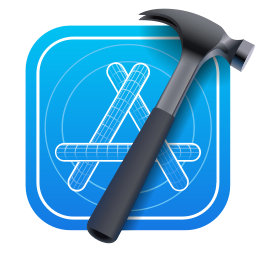

<p align="center">
  
</p>
<h1 align="center">IconVault</h1>
<p align="center"><strong>Icons for every project.</strong><br>A curated open-source collection of SVG icons for developers, tools, technologies, and brands.</p>

<p align="center"><a href="#popular-icons">Popular icons</a> &nbsp;·&nbsp; <a href="icons/">Browse all 839 icons</a> &nbsp;·&nbsp; <a href="#use-icons-in-your-project">Use the icons</a> &nbsp;·&nbsp; <a href="CONTRIBUTING.md">Contribute</a></p>

---

## Popular icons

225 different icons in a **15 × 15** grid, each displayed at about **50 × 50 px**. The original SVG vectors sit in closely spaced light tiles against a dark background, so the marks stay crisp when resized.

<p align="center">
  
</p>

## Build a custom gallery link

Open the [IconVault Gallery Builder](https://nikomarinovic.github.io/icon-vault/), choose icons, set the rows, spacing, alignment, size, and background, then copy your link. The link keeps those settings so someone can open the same gallery in a browser.

## Use icons in your project

Use an icon directly from GitHub with its raw SVG URL. Replace the filename in the URL with the exact file from [`icons/`](icons/).

### Add one icon to HTML

```html

```

### Add one icon to Markdown

```markdown

```

### Show icons in rows in your README

Put one image for each icon inside a paragraph. Use `&nbsp;` between images for a small, consistent gap, and start a new paragraph for the next row.

```html
<p align="center">
  &nbsp;
  &nbsp;
  &nbsp;
  
</p>
<p align="center">
  &nbsp;
  &nbsp;
  &nbsp;
  
</p>
```

**Rendered example:**

<p align="center">
  &nbsp;
  &nbsp;
  &nbsp;
  
</p>
<p align="center">
  &nbsp;
  &nbsp;
  &nbsp;
  
</p>

### Download icons into your project

```bash
mkdir -p public/icons
curl -L "https://raw.githubusercontent.com/nikomarinovic/icon-vault/main/icons/spotify.svg" -o public/icons/spotify.svg
```

Then use `public/icons/spotify.svg` from your app or README.

## Add an icon to IconVault

Copy the SVG into [`icons/`](icons/) and follow [CONTRIBUTING.md](CONTRIBUTING.md). Include the source and license information.

## Contributors

- [Niko Marinović](https://github.com/nikomarinovic)
