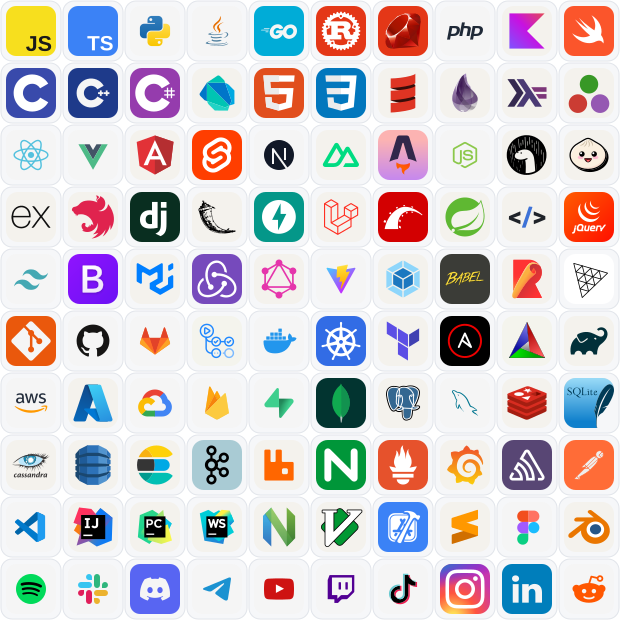
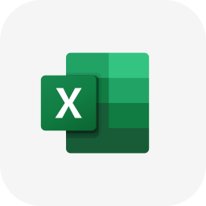
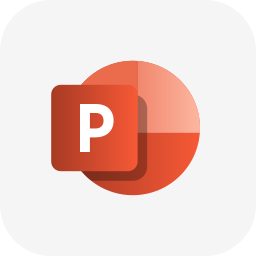
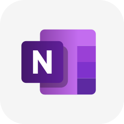
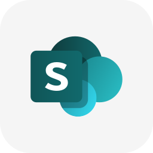
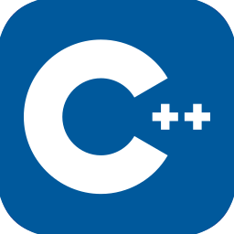

<p align="center">
  
</p>
<h1 align="center">IconVault</h1>
<p align="center"><strong>Icons for every project.</strong><br>A collection of SVG icons for developers, tools, technologies, and brands.</p>

<p align="center"><a href="#popular-icons">Browse popular icons</a> &nbsp;·&nbsp; <a href="icons/">All 805 SVG files</a> &nbsp;·&nbsp; <a href="CONTRIBUTING.md">Contribute</a></p>

---

## Popular icons

A hand-picked preview of 100 familiar developer tools, technologies, and services. The contact sheet has **10 columns × 10 rows**, with each icon displayed at **50 × 50 px**. Every icon appears once; light and dark duplicate variants are left out of this preview. The full collection remains in [`icons/`](icons/).

<p align="center">
  
</p>

## Make a gallery with one link

Open the [IconVault Gallery Builder](https://nikomarinovic.github.io/icon-vault/), search the library, and click icons to add or remove them. Each SVG file, including light and dark variants, appears as its own icon. Choose **One row** or **Custom** to set how many icons appear on each row. Set the exact gap between icons and align each row left, center, or right. The live preview shows only the icons, and the shareable link updates with your layout, size, and spacing. Use **Copy link** to share your gallery.

The builder includes all SVG files in this repository.

The gallery page needs GitHub Pages enabled for this repository (Settings → Pages → deploy from the `main` branch). README files cannot run the gallery page inside an image, so the examples below show the selected icons as static previews; click a preview to open the live, interactive gallery.

### Example galleries

Open either link to see the gallery exactly as it will look. Use the **Copy link** button on the page to copy a shareable URL, or copy a URL below.

**Office suite** — a single row of Microsoft Office icons.

<p align="center"><a href="https://nikomarinovic.github.io/icon-vault/?icons=word%2Cexcel%2Cpowerpoint%2Coutlook%2Conenote%2Csharepoint%2Conedrive&layout=single&size=64&gap=16&align=left"></a></p>

[Open live preview](https://nikomarinovic.github.io/icon-vault/?icons=word%2Cexcel%2Cpowerpoint%2Coutlook%2Conenote%2Csharepoint%2Conedrive&layout=single&size=64&gap=16&align=left)

```text
https://nikomarinovic.github.io/icon-vault/?icons=word%2Cexcel%2Cpowerpoint%2Coutlook%2Conenote%2Csharepoint%2Conedrive&layout=single&size=64&gap=16&align=left
```

**Programming languages** — a centered grid with four icons per row.

<p align="center"><a href="https://nikomarinovic.github.io/icon-vault/?icons=c%2Ccpp%2Ccs%2Chtml%2Ccss%2Cjavascript%2Ctypescript%2Cpython&layout=custom&perrow=4&size=64&gap=16&align=center">&nbsp;&nbsp;&nbsp;&nbsp;&nbsp;&nbsp;&nbsp;&nbsp;&nbsp;&nbsp;&nbsp;&nbsp;<br>&nbsp;&nbsp;&nbsp;&nbsp;&nbsp;&nbsp;&nbsp;&nbsp;&nbsp;&nbsp;&nbsp;&nbsp;</a></p>

[Open live preview](https://nikomarinovic.github.io/icon-vault/?icons=c%2Ccpp%2Ccs%2Chtml%2Ccss%2Cjavascript%2Ctypescript%2Cpython&layout=custom&perrow=4&size=64&gap=16&align=center)

```text
https://nikomarinovic.github.io/icon-vault/?icons=c%2Ccpp%2Ccs%2Chtml%2Ccss%2Cjavascript%2Ctypescript%2Cpython&layout=custom&perrow=4&size=64&gap=16&align=center
```

To use a single icon directly, use its raw SVG URL, such as [Spotify SVG](https://raw.githubusercontent.com/nikomarinovic/icon-vault/main/icons/spotify.svg). To download it, save that link into your project.

### Add an icon to IconVault

To contribute an icon here, copy its SVG into `icons/` and follow [CONTRIBUTING.md](CONTRIBUTING.md). Include its source and license.

## License

See [`LICENSE`](LICENSE). Individual icons may have separate terms; check the source and license before use.
