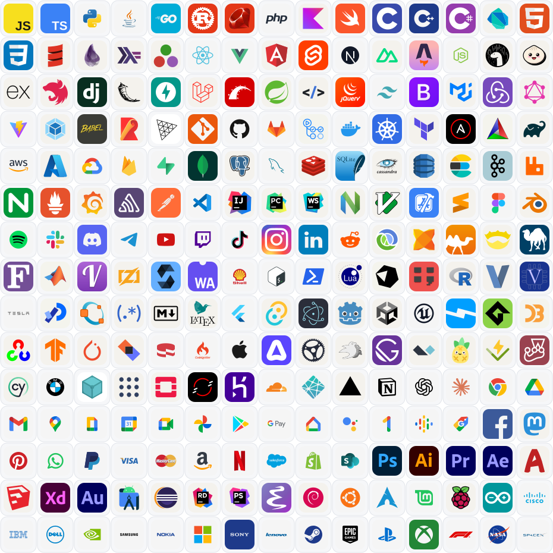

<p align="center">
  
</p>

<h1 align="center">IconVault</h1>

<p align="center">
  <strong>Icons for every project.</strong><br>
  A curated open-source collection of icons for developers, tools, technologies, and brands.
</p>

<p align="center">
  <a href="#popular-icons">Popular</a>
  &nbsp;&nbsp;&nbsp;&nbsp;
  <a href="#gallery-builder">Gallery Builder</a>
  &nbsp;&nbsp;&nbsp;&nbsp;
  <a href="#examples">Examples</a>
  &nbsp;&nbsp;&nbsp;&nbsp;
  <a href="#add-icons-manually">Add icons</a>
  &nbsp;&nbsp;&nbsp;&nbsp;
  <a href="#contributing">Contribute</a>
</p>

---

<a name="popular-icons"></a>
## Popular icons

225 different icons in a **15 × 15** grid. The original SVGs stay crisp at any size.

<p align="center">
  
</p>

<a name="gallery-builder"></a>
## Gallery Builder

Open the **[IconVault Gallery Builder](https://icon-vault.netlify.app/)** to select icons, preview the layout, and copy either a share link or Markdown image code.

The `/image` endpoint returns one combined SVG image. Use comma-separated icon keys and adjust `size`, `gap`, `align`, and `row` in its URL.

<a name="examples"></a>
## Examples

Each example shows the Markdown to paste into a README, followed by the rendered image.

### Inline row

```markdown

```


### Dark variants

```markdown

```


### Grid, 4 per row

```markdown

```


### Developer tools

```markdown

```


<a name="add-icons-manually"></a>
## Add icons manually

Write the Markdown image link directly. Replace the names in `icons=` with any keys from the collection:

```markdown

```

The `row` option is optional. For example, remove `&row=4` to place every selected icon on one row. `gap` accepts values from `0` to `256`.

The builder creates both forms for you. **Copy Markdown** makes the image embed; **Copy HTML** wraps it in a centered paragraph so it appears centered in a GitHub README. The `align` URL option positions icons inside the image rows, while the HTML wrapper positions the whole image on the README page.

<a name="contributing"></a>
## Contributing

Missing an icon? Add it to the [`icons/`](icons/) collection and follow [CONTRIBUTING.md](CONTRIBUTING.md). Please include the source and license information.

## Contributors

<p align="center">
  <a href="https://github.com/nikomarinovic">
    
  </a>
  <br>
  <a href="https://github.com/nikomarinovic"><sub><b>Niko Marinović</b></sub></a>
</p>
